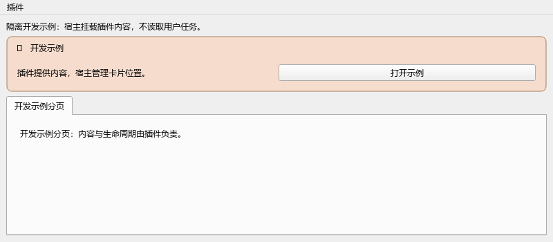
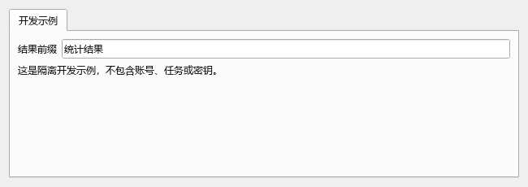
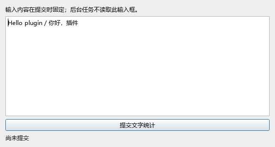

# 视频辅助工具 · 开发者手册

面向维护者、插件作者和协作开发的 AI。根据 **2026-10-25 当前工作树**核对，宿主插件 API 版本为 **1**。这是仓库内部扩展接口，不是支持热安装、权限沙箱或长期二进制兼容的外部 SDK。源码有变化时，应同时更新示例和接口校验测试。

本目录仅随源码保存。正式 EXE / ZIP 不包含开发者文档、示例或截图。用户功能说明仍在 [`docs/`](../)；历史功能记录在 [`CHANGELOG.md`](../../CHANGELOG.md)。

## 从哪里开始

| 要完成的工作 | 阅读 |
|---|---|
| 第一次开发、理解目录与职责 | [架构与开发环境](01-architecture.md) |
| 注册菜单、窗口、卡片、分页、程序设置 | [插件与 UI 接口](02-plugin-ui.md) |
| 耗时处理、进度、取消、重试、退出 | [后台任务与线程](03-background-tasks.md) |
| 自定义节点、工作流类型、媒体输入 | [节点与工作流](04-nodes.md) |
| 保存配置、插件数据、密盘、日志和授权 | [数据与服务](05-data-services.md) |
| 写测试、定位逻辑错误、源码提交和打包 | [测试与发布](06-testing-release.md) |
| 交给另一个 AI 开发前的约束 | [AI 开发交接清单](07-ai-checklist.md) |
| 可直接阅读、复制并运行测试的完整实现 | [示例插件](examples/sample_plugin.py) |

## 五条先记住的规则

1. **业务归插件，通用能力归宿主。** 不为每个功能往 `MainDialog` 增加一套业务处理、设置与后台线程。
2. **提交时固定输入。** 后台不能重新读取当前选中任务、控件文本或可变全局项目。
3. **耗时操作不进 GUI 线程。** 网络、编码、模型和磁盘扫描必须有边界、取消及资源释放策略。
4. **失败不能假成功。** 不明付费请求不能靠盲目重试恢复；任务/账号失败不能无限占住全局队列。
5. **数据位置不是固定盘符。** 私有数据使用宿主存储，成品使用本次任务目标；不得复制账号、Key 和用户内容进文档。

## 示例画面

以下为真实 Qt 控件的**隔离开发示例**，不是生产主界面截图，不含用户任务或账号。用于说明各注册入口的区别。

## 接口定位

| 接口或职责 | 源码 |
|---|---|
| 注册描述对象 | [`app_plugins/api.py`](../../app_plugins/api.py) |
| 上下文、安装与生命周期 | [`app_plugins/host.py`](../../app_plugins/host.py) |
| 内置插件公开导出 | [`app_plugins/builtin/__init__.py`](../../app_plugins/builtin/__init__.py) |
| 当前显式安装清单 | [`PYUI/main_pyui.py`](../../PYUI/main_pyui.py) |
| 后台任务与并发限制 | [`BackgroundTasks.py`](../../model/BackgroundTasks.py)、[`BackgroundTaskSettings.py`](../../model/BackgroundTaskSettings.py) |
| 安全 QThread 结束处理 | [`QtThreadLifecycle.py`](../../model/QtThreadLifecycle.py) |
| 节点值与注册 | [`contracts.py`](../../model/node_workflow/contracts.py)、[`graph.py`](../../model/node_workflow/graph.py) |
| 受管存储 | [`AppDataStorage.py`](../../model/AppDataStorage.py) |

文档里的路径均相对仓库，不记录开发者电脑上的绝对目录。接口以源码实现为准；不要按名称猜测未提供的 API。
