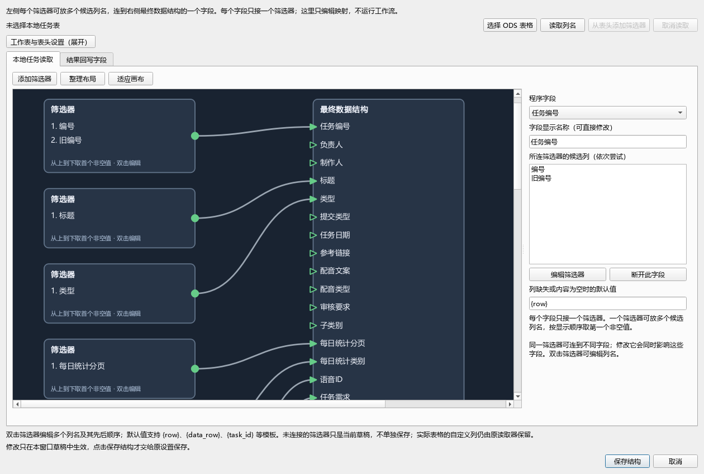

# 任务表格：节点式结构编辑

2026-10-25。入口：**程序设置 → 任务表格 → 节点式编辑结构…**。原“打开任务表格结构设置…”按钮保留，两种编辑方式读写同一份 `task_table_schema`。

截图使用通用示例数据，不含实际客户表头或账号。

## 两种节点

- **筛选器**：可建立多个，每个里面存多个候选列名，按从上到下的顺序读取。前一个列不存在或当前行内容为空，才继续尝试下一个。
- **最终数据结构**：只有一个；每个字段端口只允许接一个筛选器。一个筛选器可同时连接不同字段，修改它时这些字段一起变化。

例如在一个筛选器里依次填写“任务名称”“标题”“中文标题”，再连到右侧“任务名称”即可。不要为这三个别名分别建立三条输入线。

## 操作

1. 点击“添加筛选器”，每行填写一个候选列名。列名和顺序直接显示在卡片上；内容多或名称长会增加节点高度/宽度，不强制缩小字体。
2. 拖动筛选器右侧输出端口，连到最终数据结构左侧的字段。也可先点输出、再点输入。
3. 双击筛选器修改候选列名及顺序。右键可删除筛选器或断开连线；右侧“断开此字段”仅断开当前字段。
4. 右侧“字段显示名称”直接修改界面称呼，不改内部字段标识。默认采用通用中文，已有本地自定义名称优先保留；内部标识只在提示中用于排查。
5. 必要时设置缺失/空值的默认值，支持原有 `{row}`、`{data_row}`、`{task_id}` 等模板。模板中的内部标识不是表格列名，不能随显示名称一起改。
6. 点击“保存结构”才保存；取消不写入。下次加载任务/整理结果时应用，不改当前已加载任务。

鼠标中键平移、滚轮缩放；“整理布局”把筛选器排在左侧，避免线穿过其他节点；“适应画布”用于查看整体。

## 从本地表格取列名

选择 ODS 后点击“读取列名”，后台读取表头，不写表格、不访问 Google。然后点击“从表头添加筛选器”，在弹出的清单中保留当前筛选器需要的候选列。

若全新表格的表头无法自动判断，展开“工作表与表头设置”，明确指定工作表和表头行号，再读取。不静默猜一行来保存错误映射。读取可以取消，解析安全结束后恢复按钮。

“结果回写字段”分页编辑现有 Google 回写映射；它不会联网读取在线表头，列名手动填写。更改显示名称与实际表格列名是两件事：原表英文列名要照原样保留，不能为了界面中文化翻译后再去匹配。

## 保存与兼容

仍保存字段别名、默认值和显示名称，不建立可运行的工作流，不更改原 ODS 解析/回写算法。未连线的筛选器只是草稿，不进入保存的映射；重新打开会依据已保存字段生成筛选器并整理位置，不保存独立画布布局。其他实际表格列仍保留在原始字段中，不因没连线而丢掉。

程序内部字段集合仍由源码定义。这里只映射已有程序字段；任意新增的业务字段不会仅凭改一个中文名称就自动获得配音、渲染或回写功能。
