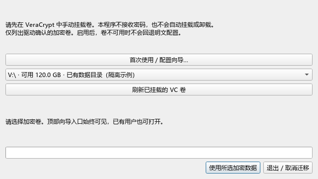
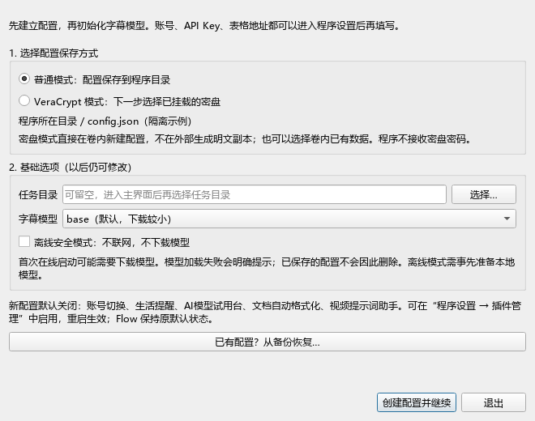
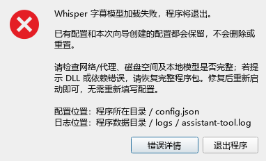

# 首次使用向导

首次运行且没有配置时，先打开向导，再初始化字幕模型。已有 `config.json` 或密盘启动绑定时，不重复弹出，也不会重置账号和历史。

## 从启动窗口随时进入

启动时的 **“VeraCrypt · 选择加密数据卷”** 窗口，顶部固定提供 **“首次使用／配置向导…”** 按钮。有配置也能点击，不需要删除配置来触发。它属于原有选盘窗口，不会额外增加一个每次必点的新启动窗口。

- **已有用户**：可反复查看挂载、选盘和程序设置的操作步骤。向导不会读取原明文配置、修改密盘绑定、覆盖账号或重置插件开关。关闭向导仍停留在原选盘窗口，保留所选卷。
- **全新用户**：可填写或修改首次配置草稿，再返回选盘；草稿只在内存中，明确确认“新建首次配置到所选卷”后才写入密盘。取消子向导不退出选盘窗口，草稿也不会写入外部。
- 复制／校验正在进行时，入口暂时禁用，避免同时改动本轮配置；完成或失败返回选盘后恢复。已绑定或存在旧数据时不允许通过该入口创建空配置顶替。

## 创建配置

1. **普通模式**：在程序目录新建 `config.json`。目录不可写会明确提示，请将完整程序目录移动到可写位置再试，不自动转存其他地方。
2. **VeraCrypt 模式**：先手动挂载密盘，向导下一步选择卷；可以使用已有数据，或在卷内新建首次配置。不会在程序目录先生成明文配置，也不接收密码。以后启动需要挂载绑定卷。
3. 任务目录可留空，以后在主界面选择；字幕模型默认 base，首次在线使用可能下载模型。账号、Key、表格地址进入设置后再填。
4. 离线模式不下载模型；本次由命令行强制离线时不能在向导中取消。

新配置默认关闭 Codex/Antigravity 账号切换、生活提醒、AI模型试用台、文档自动格式化、视频提示词助手；Flow、文案视频和配音字幕等制作功能保持原默认。可在程序设置的插件管理中启用并重启。已有用户的开关不会被这些默认值重写。

必须保留完整程序包，包括 `_internal` 和 `config.example.json`。模板缺失、配置文件已由其他进程建立、目录不可写时，都不会覆盖现有文件。

## 旧数据与恢复

没有主配置但存在旧凭据、历史或配置副本时，向导只允许从备份恢复或退出，不创建空配置伪装成“全新使用”。恢复操作明确确认保存位置，原备份与其他记录保留。

已经绑定的密盘丢失配置、未挂载或卷身份不符时，继续走原有存储检查，不提供“忽略并新建空配置”来绕过。首次卷内创建失败的中间目录只保留在密盘中；程序不会在外部生成敏感备份。若卷内已有完整配置但程序目录保存启动绑定失败，卷内副本仍保留，可解决写权限后再选择“使用已有数据”。

## Whisper 初始化失败

在线启动加载失败会弹出“程序初始化失败 · 字幕模型”，说明程序将退出、配置会保留，并提供配置位置、日志位置和可展开的错误详情。检查网络/代理、磁盘空间、模型完整性；DLL/依赖报错时恢复完整程序包，再重新启动，不要因此删除配置。

原有离线策略保留：本地模型不可用时明确警告，其他离线本地功能仍可使用。向导创建成功后即使模型失败，下次也不会要求重新填写全部配置。
